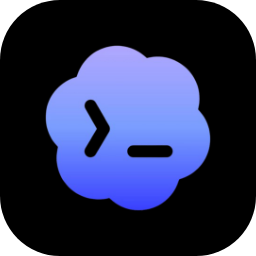
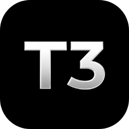

<h2>Hi, I'm Jatin Rathore 👋</h2>

## About

- 🔭 Software Engineer at **Skydo**, building payments and banking integrations for exporters.
- 🧩 2+ years in **fintech**, shipping **RESTful APIs**, **microservices**, and web applications end to end.
- 🤖 **AI-native** workflow: I direct AI agents for documentation, coding, reviews, and testing.
- 🎓 B.Tech, **Indian Institute of Technology Madras**.

## Tech stack

  <picture><source media="(prefers-color-scheme: dark)" srcset="https://skillicons.dev/icons?i=ts&theme=dark" /></picture>
  <picture><source media="(prefers-color-scheme: dark)" srcset="https://skillicons.dev/icons?i=js&theme=dark" /></picture>
  <picture><source media="(prefers-color-scheme: dark)" srcset="https://skillicons.dev/icons?i=kotlin&theme=dark" /></picture>
  <picture><source media="(prefers-color-scheme: dark)" srcset="https://skillicons.dev/icons?i=py&theme=dark" /></picture>
  <picture><source media="(prefers-color-scheme: dark)" srcset="https://skillicons.dev/icons?i=go&theme=dark" /></picture>
  <picture><source media="(prefers-color-scheme: dark)" srcset="https://skillicons.dev/icons?i=cpp&theme=dark" /></picture>
  <picture><source media="(prefers-color-scheme: dark)" srcset="https://skillicons.dev/icons?i=react&theme=dark" /></picture>
  <picture><source media="(prefers-color-scheme: dark)" srcset="https://skillicons.dev/icons?i=nextjs&theme=dark" /></picture>
  <picture><source media="(prefers-color-scheme: dark)" srcset="https://skillicons.dev/icons?i=redux&theme=dark" /></picture>
  <picture><source media="(prefers-color-scheme: dark)" srcset="https://skillicons.dev/icons?i=tailwind&theme=dark" /></picture>
  <picture><source media="(prefers-color-scheme: dark)" srcset="https://skillicons.dev/icons?i=nodejs&theme=dark" /></picture>
  <picture><source media="(prefers-color-scheme: dark)" srcset="https://skillicons.dev/icons?i=spring&theme=dark" /></picture>
  <picture><source media="(prefers-color-scheme: dark)" srcset="https://skillicons.dev/icons?i=fastapi&theme=dark" /></picture>
  <picture><source media="(prefers-color-scheme: dark)" srcset="https://skillicons.dev/icons?i=postgres&theme=dark" /></picture>
  <picture><source media="(prefers-color-scheme: dark)" srcset="https://skillicons.dev/icons?i=mongodb&theme=dark" /></picture>
  <picture><source media="(prefers-color-scheme: dark)" srcset="https://skillicons.dev/icons?i=redis&theme=dark" /></picture>
  <picture><source media="(prefers-color-scheme: dark)" srcset="https://skillicons.dev/icons?i=elasticsearch&theme=dark" /></picture>
  <picture><source media="(prefers-color-scheme: dark)" srcset="https://skillicons.dev/icons?i=rabbitmq&theme=dark" /></picture>
  <picture><source media="(prefers-color-scheme: dark)" srcset="https://skillicons.dev/icons?i=aws&theme=dark" /></picture>
  <picture><source media="(prefers-color-scheme: dark)" srcset="https://skillicons.dev/icons?i=docker&theme=dark" /></picture>
  <picture><source media="(prefers-color-scheme: dark)" srcset="https://skillicons.dev/icons?i=nginx&theme=dark" /></picture>
  <picture><source media="(prefers-color-scheme: dark)" srcset="https://skillicons.dev/icons?i=git&theme=dark" /></picture>
  
  
  

## Featured projects

| Project | What it is | Stack |
|---|---|---|
| [AgentTrace-CloudFlare](https://github.com/JatinRathore101/AgentTrace-CloudFlare) | AI agent application running on Cloudflare Workers | TypeScript, Workers AI, Durable Objects, Redux Toolkit, MUI |
| [async_order_processing_system](https://github.com/JatinRathore101/async_order_processing_system) | Asynchronous order processing backend | Go, PostgreSQL, NATS JetStream |
| [Multi-tenant RBAC API](https://github.com/JatinRathore101/Fastify-PG-Project---Multi-Tenanted-Role-Based-Access-Control-System) | Multi-tenanted, role-based access control authentication API | Node.js, TypeScript, Fastify, Drizzle ORM, PostgreSQL |
| [companies-dashboard](https://github.com/JatinRathore101/companies-dashboard) | Full-stack dashboard application | Next.js, Redux, MUI |
| [leetcode-problems-tracker](https://github.com/JatinRathore101/leetcode-problems-tracker) | Tracker for LeetCode problem-solving progress | Next.js |

## GitHub stats

  <picture>
    <source media="(prefers-color-scheme: dark)" srcset="https://github-profile-summary-cards.vercel.app/api/cards/profile-details?username=JatinRathore101&theme=github_dark" />
    
  </picture>

  <picture>
    <source media="(prefers-color-scheme: dark)" srcset="https://github-profile-summary-cards.vercel.app/api/cards/repos-per-language?username=JatinRathore101&theme=github_dark" />
    
  </picture>
  <picture>
    <source media="(prefers-color-scheme: dark)" srcset="https://github-profile-summary-cards.vercel.app/api/cards/stats?username=JatinRathore101&theme=github_dark" />
    
  </picture>

  <picture>
    <source media="(prefers-color-scheme: dark)" srcset="https://streak-stats.demolab.com/?user=JatinRathore101&theme=github-dark-blue&hide_border=true" />
    
  </picture>
  <picture>
    <source media="(prefers-color-scheme: dark)" srcset="https://leetcard.jacoblin.cool/jatinrathore10120914?theme=dark" />
    
  </picture>

## Connect

  
  

